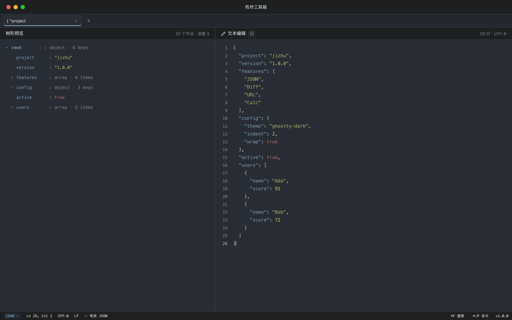

# jizhu · 机杼工具箱

[**English**](README.md) · [简体中文](README.zh-CN.md)

> A local-first, keyboard-first data workbench for developers.

No account, no telemetry. Local processing by default; only explicit cURL request/diff actions contact a target URL.

> **Public version 1.0.0 · Tiling workspace · source-only**
> macOS-first. The app is a dark tiling workspace with plain/JSON editors and tool panels.



## Source-only release

This repository is **source-only**:

- No `.app`, `.dmg`, notarized binary, or auto-updater is published.
- A locally built `.app` (debug or release) is for local verification only; it is unsigned and not notarized.
- A future binary release still needs Developer ID signing, notarization, checksums, SBOM and updater signing.

## Tiling workspace

- One tab is a **numbered workspace**, not a single tool page.
- A workspace is a Plain / JSON / Calc editor; one normal Diff panel or one side tool can be open at a time.
- Panels and side tools open from the command palette.
- `Esc` no longer closes tools; `⌘W` asks before closing the current tool/panel or a tab with content, and the confirmation names the exact tool or workspace. Empty tabs close directly; tool state stays on the tab and is restored on reopen.
- The interface is **dark-only**.

## Features

- **Editor**
  - Plain, JSON and Calc modes; switching to JSON opens the synchronized tree by default (hide/show supported).
  - Tree min width is 150px; JSON indent is configurable, default 2 spaces.
  - CodeMirror 6: line numbers, search, undo/redo, selection, large-document handling.
  - `⌘F` find/replace; `Ctrl+Z` or the command palette undoes.
  - UTF-8 and LF displayed in the status bar; word wrap is on by default and toggleable from the command palette.
  - No file open/save in this milestone — content is typed/pasted and restored locally.
- **Command palette** (`⌘⇧P`)
  - Open tools, choose the editor mode (Plain / JSON / Calc), undo, format/minify, copy, open settings.
  - Every command has a searchable English alias (e.g. `settings` finds 设置).
- **Input sources**
  - Only Diff keeps a source selector: selected text, current workspace tab, or manual input.
  - QR / URL / Encode-decode / Time / jq / Regex / Pipeline / Data format / cURL read the left editor directly and have no separate input field.
- **Panels**
  - jq query, Diff, QR, Pipeline, URL inspector, Time, Regex, Encode/decode, Data format, cURL request.
  - QR / URL / Encode-decode / Time / jq / Regex / Pipeline / Data format / cURL request are singleton side splits with a draggable divider, sharing the same editor-left / tool-right layout. Only one side tool is open at a time.
  - QR is a singleton editor/preview split: the left editor content feeds the right preview, with no separate QR input field. The preview has no card background and uses 75% of the available pane size. Drag the divider to resize; double-click resets.
  - Diff supports text / JSON structure / URL structure / cURL responses. cURL mode runs both commands, then compares the original command, sorted response headers, and JSON-formatted body.
  - JSON formatting keeps an object on one line when its spaced dump is under 79 characters; larger objects put each key on its own line. Arrays stay multi-line, with small nested objects inlined.
  - URL inspector keeps key/value fields equal width and recursively displays URL-valued query parameters up to 3 levels.
  - Regex uses Python-style syntax (`(?P<name>...)`, `(?P=name)`, lookarounds), shows `matchN start-end text`, highlights every match in the editor, and marks the selected match. Match/aggregate lists are virtualized; replacement is a separate on-demand tab with sortable result/count/percentage rows.
  - Data format converts YAML / TOML ↔ JSON from the left editor, with copy and write-back.
  - cURL request parses the left editor's curl command and shows response headers/body on demand; nothing is sent until “发送”.
  - cURL request supports common flags (`-X`, `-H`, `-d`, `--json`, `-L`, `-k`, `-u`, `-A`, `-b`); multipart forms and @file bodies are not supported yet.
  - Pipeline uses the left editor as its only input; its right pane has numbered step rows on top and results below, with inline step configuration. jq/codec/regex/count steps and workflow import/export remains; exported workflow JSON contains only version/name/steps, never editor data.
  - QR preview supports copy/zoom; file export is intentionally not exposed in this milestone.
- **Settings**: dark theme fixed, editor font size, JSON indent, language, shortcuts, about. Wrap defaults on. Open it from the command palette; `⌘,` is no longer bound.
  - The bottom status bar is interactive: click `PLAIN`/`JSON`/`CALC` to switch the editor language; click `⌘F 搜索` to open the editor find bar; click `⌘⇧P 命令` to open the command palette.
- **Calc mode (MVP)**: four-operator arithmetic, precedence/parentheses, one independent expression per line, and inline results at line end. Evaluation is debounced by 400ms; existing answers stay visible while typing and are only rebuilt when the calculated data actually changes. Variables (`price = 100`, `price * 2`) are substituted in the answer, e.g. `2 * 8 = 16`; a line containing only a variable shows its value. Built-ins: `abs, sqrt, round, floor, ceil, min, max, pow, mod, log` (base 10), `ln, exp, sin, cos, tan` (radians), `sum`, plus constants `pi` and `e`. A Calc help card appears for empty documents with examples and a fill button. Syntax, undefined-variable and division-by-zero errors stay inline; prose lines are ignored.
- **Theme**: Ghostty-inspired dark palette (`#282c34` base, `#ffffff` foreground, Tomorrow Night ANSI colors), mapped to UI surfaces and syntax highlighting. See [THIRD_PARTY_NOTICES.md](THIRD_PARTY_NOTICES.md).
- **Security**: strict CSP, `withGlobalTauri: false`, no fs/shell/http plugins, jaq/regex sandboxed in worker subprocesses. jq no longer invokes a system `jq` binary. The cURL tool invokes the fixed system `/usr/bin/curl` binary with argument arrays (no shell interpolation) and only after an explicit user action.
- **Session restore**: workspace tabs, documents, panel layout and tool state persist locally.

## Shortcuts

| Shortcut | Action |
| --- | --- |
| `⌘⇧P` | Command palette |
| `⌘F` | Find / replace in editor |
| `⌘Z` / `⌘⇧Z` / `Ctrl+Z` | Undo / redo |
| `Tab` / `Shift+Tab` | Indent / outdent |
| `⌘1`–`⌘9` | Switch tab; no-op when missing (never types a digit) |
| `⌘W` | Close tool/panel or tab; confirmation names the target |
| `Esc` | Close dialog / cancel confirmation (does not close tools) |

## Requirements

- macOS 13+
- Xcode Command Line Tools
- Rust 1.93.1 (see `rust-toolchain.toml`)
- Node.js >= 22.12 and npm

## Run from source

```bash
npm install
npm run tauri dev
```

Build a local debug app (unsigned, for development only):

```bash
npm run tauri build -- --debug --bundles app
open target/debug/bundle/macos/jizhu.app
```

## Checks

```bash
npm run typecheck
npm run build
node scripts/tiling-ui-check.mjs   # shell, panels, tree, sources
node scripts/feature-check.mjs     # all tool panels with mocked IPC
node scripts/calc-ui-check.mjs     # Calc results, help card and stability
```

Older `scripts/*-ui-check.mjs` target the previous single-tool layout and are kept for reference only.

## Project layout

```text
src/                 React 19 + TypeScript UI
src/components/workspace/  Tiling shell, panels, plain editor
crates/jizhu-core/   Pure Rust: JSON, jq/jaq, diff, regex
src-tauri/           Tauri shell, commands, workers, capabilities
scripts/             UI and dependency checks
```

## Privacy and security

- No telemetry. The application does not initiate network requests on its own; only the explicit cURL request/diff actions contact the target URL.
- No filesystem access from the webview; no fs/shell/http plugins. cURL uses a fixed system binary, not a shell.
- jaq and regex run in limited worker subprocesses; jq execution is self-contained.
- Report vulnerabilities privately via [SECURITY.md](SECURITY.md), not a public issue.

## Known limitations

- Only Diff uses the normal tiled panel; other tools use singleton side splits. No nested splits.
- No file open/save; use paste and local session restore.
- Regex replacement remains available inside the regex panel.
- The older UI checks are not part of CI.

## License

[MIT](LICENSE)
