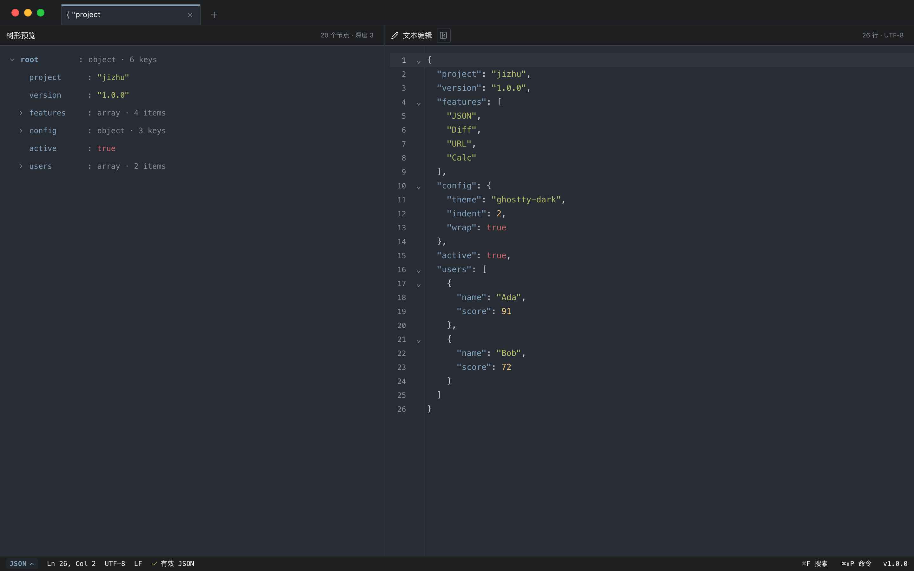

# 机杼工具箱 · jizhu

[English](README.md) · **简体中文**

> 把开发日常里的数据，织成你要的样子。

本地优先、键盘优先的开发者数据加工台。默认不发起网络请求、不登录、不上传；只有显式使用 cURL 工具时才会访问目标 URL。

> **公开版本：1.1.0 · Tiling 工作区 · source-only（不提供签名二进制）**
> macOS 优先。Sublime 风格的简洁平铺工作区 + plain/JSON 编辑器 + 工具面板，支持多主题。



## 发布形态

当前 GitHub 仓库是 **source-only**：

- 只发布源代码，不附带 `.app`、`.dmg` 或自动更新；
- 本机 debug `.app` 仅用于开发验证，未签名、未公证；
- macOS 用户从源码构建时可能遇到 Gatekeeper 提示。

正式二进制发布前还需要：Developer ID 签名、公证/stapling、SHA256、SBOM、更新器签名。

## Tiling 工作区

- 一个标签是一个**编号工作区**，不再是单个工具页。
- 工作区里是 Plain / JSON / Calc 编辑器；可打开一个普通 Diff 面板或一个右侧工具。
- 面板和右侧工具通过命令面板打开。
- `Esc` 不再关闭工具；`⌘W` 会先确认要关闭的当前工具/面板或有内容的标签，弹窗会写明具体工具名或工作区标题。空标签直接关闭；工具状态保留在标签上，重新打开会恢复。
- 默认浅色；设置中提供 Ghostty Dark、Solarized Light / Solarized Dark。

## 已实现

- **编辑器**
  - JSON 模式支持折叠栏、折叠占位符和 CodeMirror 折叠快捷键。
  - Plain / JSON / Calc 三种模式；切换 JSON 默认打开同步树，可隐藏/恢复。
  - 树最小宽度 150px；JSON 缩进可配置，默认 2 空格。
  - CodeMirror 6：行号、搜索、撤销/重做、选区、大文档降级。
  - `⌘F` 查找/替换；`Ctrl+Z` 或命令面板撤销。
  - 状态栏显示 UTF-8 与 LF；自动换行默认开启，可在命令面板或设置中切换。
  - 本阶段不支持文件打开/保存；内容通过输入/粘贴和本地会话恢复。
  - 空白编辑器（新建或清空后）粘贴 JSON 对象/数组会自动切换到 JSON；粘贴其它内容则切换回 Plain。
- **快捷命令 / 命令面板**（`⌘⇧P`）
  - 默认打开单键命令列表，不聚焦输入框，避免中文输入法拖慢操作。
  - 按 `S` 设置、`V` 模式、`F` 格式化 JSON、`M` 压缩、`G` Mermaid、`J` jq、`D` Diff、`R` 正则等；每个命令左侧显示对应按键。
  - 按 `/` 切换到可搜索列表；每个命令都有英文别名，例如输入 `settings` 可找到“设置”。
- **输入源**
  - Diff 是剩余的唯一普通平铺面板，有输入源选择：选中文本、当前标签、手动输入。
  - 二维码、URL、编码/解码、时间转换、jq、正则改为右侧分屏，直接读取左侧编辑器，不再提供独立输入源；同时只允许一个右侧工具。
- **面板**
  - jq 查询、Diff、二维码、Pipeline、URL 解析、时间、正则、编码/解码、格式转换、cURL 请求、Mermaid 预览。
  - 二维码 / URL / 编码解码 / 时间转换 / jq / 正则 / Pipeline / 格式转换 / cURL 请求 / Mermaid 都是单例分屏，共用“编辑器左 / 工具右”布局和可拖拽分隔条。
  - 二维码是单例编辑器/预览分屏：左侧编辑器内容直接驱动右侧预览，不再单独提供输入框；预览没有独立背景卡片，二维码使用可用空间的 3/4；拖动中间分隔条可调整宽度，双击复位。
  - Diff 支持文本 / JSON 结构 / URL 结构 / cURL 响应。cURL 模式会执行两侧命令，再比较原始 curl、排序后的响应 headers 和格式化后的 JSON body。
  - JSON 格式化时，对象的单行 dump 长度小于 79 字符则保持一行；达到或超过 79 字符时每个 key 新起一行；数组保持多行，数组中的小对象可单行。
  - URL 解析保持参数 key/value 等宽，并递归展示值为 URL 的查询参数，最多 3 层。
  - 正则使用 Python 风格语法（`(?P<name>...)`、`(?P=name)`、环视），匹配列表显示 `matchN 起止位置 原文`；左侧编辑器高亮全部匹配并突出当前项。匹配/聚合列表虚拟化，替换为独立按需生成的 Tab；聚合行展示结果、数量、占比并支持双向排序。
  - 格式转换从左侧编辑器读取 YAML / TOML / JSON，右侧实时输出，可复制或写回。
  - cURL 请求解析左侧 curl 命令，点击“发送”后才发起请求，并展示状态、耗时、响应 headers / body。
  - Mermaid 在本地把左侧编辑器内容渲染为 SVG，支持 60–250% 缩放、重置、复制 SVG 和主题联动；打开工具时普通编辑器会高亮 Mermaid 关键字、箭头、字符串和注释。示例库分为“基础 / 真实场景”两组，共 28 个图例（流程图、时序图、类图、状态图、ER、甘特图、饼图、思维导图、用户旅程、Git 图、象限图、需求图、时间线、XY 图表、C4、桑基图，以及 API 链路、CI/CD、订单状态机、领域模型、发布计划、架构、漏斗、优先级、故障时间线、上手旅程等真实场景）。渲染防抖，错误直接在预览区展示。
  - cURL 请求支持常见参数（`-X`、`-H`、`-d`、`--json`、`-L`、`-k`、`-u`、`-A`、`-b`）；暂不支持 multipart 和 @file body。
  - Pipeline 以左侧编辑器为唯一输入；右侧上方是带表达式摘要的逐行步骤列表，下方是结果区，步骤配置内联展开。保留 jq / 编码 / 正则 / 计数步骤与工作流文本导入导出；导出的工作流只包含 version / name / steps，不包含编辑器原始数据。
  - 二维码预览支持复制和放大；本阶段不暴露文件导出。
- **设置**：Ghostty / 浅色 / Solarized 主题、编辑器字号、界面缩放、JSON 缩进、语言、快捷键、关于；自动换行默认开启。通过命令面板打开；`⌘,` 不再绑定。
  - 底部状态栏可交互：点击 `PLAIN`/`JSON`/`CALC` 切换编辑器语言；点击 `⌘F 搜索` 打开编辑器查找栏；点击 `⌘⇧P 命令` 打开命令面板。
- **Calc 模式（MVP）**：四则运算、优先级/括号、每行独立计算、行末内联结果。输入停顿 400ms 后才求值；输入期间保留已有答案，只有计算结果真正变化时才更新；变量引用会先替换成具体值，例如 `2 * 8 = 16`，单变量行直接显示变量值。内置函数：`abs、sqrt、round、floor、ceil、min、max、pow、mod、log`（10 为底）、`ln、exp、sin、cos、tan`（弧度）、`sum`、`datetime(timestamp)` / `timestamp(timestamp)`（转本地可读时间），以及常量 `pi`、`e`。空文档进入 Calc 时会显示示例卡片，可一键填入示例。语法错误、未定义变量和除以零以内联错误显示；普通文本行不计算。
- **主题**：默认浅色，另提供 Ghostty Dark、Solarized Light / Solarized Dark，映射到界面层级与语法高亮；署名见 [THIRD_PARTY_NOTICES.md](THIRD_PARTY_NOTICES.md)。
- **安全基线**：严格 CSP、`withGlobalTauri: false`、不启用 fs/shell/http 插件；jaq / 正则走独立 worker 沙箱；jq 不再调用系统 jq 二进制。cURL 工具仅在用户主动发送时调用固定 `/usr/bin/curl`，通过参数数组传递，不经过 shell。
- **会话恢复**：工作区标签、文档、面板布局和工具状态写入本地。

## 快捷键

| 快捷键 | 动作 |
| --- | --- |
| `⌘⇧P` | 快捷命令列表；`/` 搜索 |
| `⌘F` | 编辑器查找 / 替换 |
| `⌘Z` / `⌘⇧Z` / `Ctrl+Z` | 撤销 / 重做 |
| `Tab` / `Shift+Tab` | 缩进 / 反向缩进 |
| `⌘1`–`⌘9` | 切换标签；不存在时无效且不会输入数字 |
| `⌘=` / `⌘-` | 放大 / 缩小界面（10% 步进） |
| `⌘0` | 恢复界面缩放 100% |
| `⌘W` | 关闭工具/面板或标签；确认框会显示具体名称 |
| `Esc` | 关闭弹窗 / 取消确认（不再关闭工具） |

## 快速开始

### 依赖

- macOS 13+，Xcode Command Line Tools
- Rust 1.93.1（见 `rust-toolchain.toml`）
- Node.js >= 22.12 + npm

### 运行

```bash
npm install
npm run tauri dev
```

构建本地 debug 应用（未签名，仅开发验证）：

```bash
npm run tauri build -- --debug --bundles app
open target/debug/bundle/macos/jizhu.app
```

## 检查

```bash
npm run typecheck
npm run build
node scripts/tiling-ui-check.mjs   # 外壳、面板、树、输入源
node scripts/feature-check.mjs     # 全工具面板（mock IPC）
node scripts/calc-ui-check.mjs     # Calc 结果、示例卡片和稳定性
```

旧的 `scripts/*-ui-check.mjs` 面向上一版单工具布局，仅保留参考。

## 项目结构

```text
src/                 React 19 + TypeScript UI
src/components/workspace/  Tiling 外壳、面板、plain 编辑器
crates/jizhu-core/   纯 Rust：JSON、jq/jaq、diff、regex
src-tauri/           Tauri 外壳、命令、worker、capabilities
scripts/             UI 与依赖检查
```

## 隐私

- 无遥测。应用不会自行发起网络请求；只有显式使用 cURL 请求/对比时才会访问目标 URL。
- 本阶段不从 webview 访问文件系统；不启用 fs/shell/http 插件。cURL 使用固定系统二进制，不经过 shell。
- jaq / 正则运行在受限 worker 子进程中；jq 执行不依赖系统 shell。
- 漏洞请通过 [SECURITY.md](SECURITY.md) 私下报告，不要开公开 issue。

## 已知限制

- 只有 Diff 使用普通平铺面板；其他工具使用单例右侧分屏，不支持嵌套分栏。
- 不支持文件打开/保存；使用粘贴和本地会话恢复。
- 正则替换仍在正则面板内提供。
- 旧 UI 检查脚本不纳入 CI。

## 许可证

[MIT](LICENSE)
